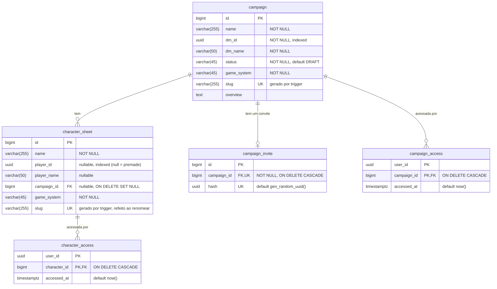

# QuestMaster database

Each service owns its own database. Game system modules reference core entities through `core_*` columns (e.g. `core_character_sheet_id`, `core_campaing_id`) instead of foreign keys across databases.

## Core

## Call of Cthulhu

## Ghostbusters

